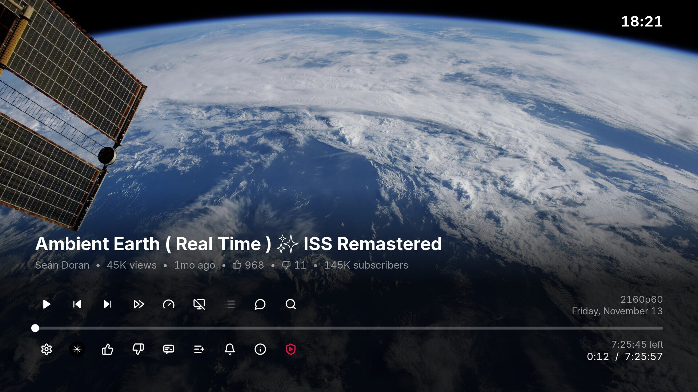
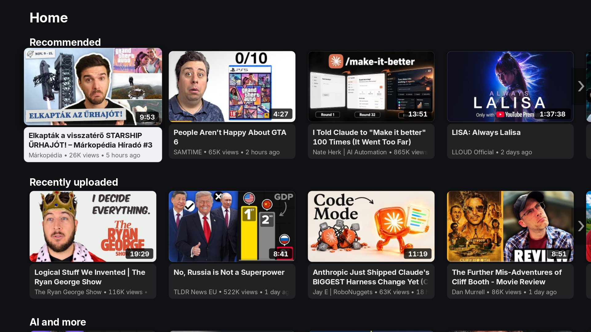
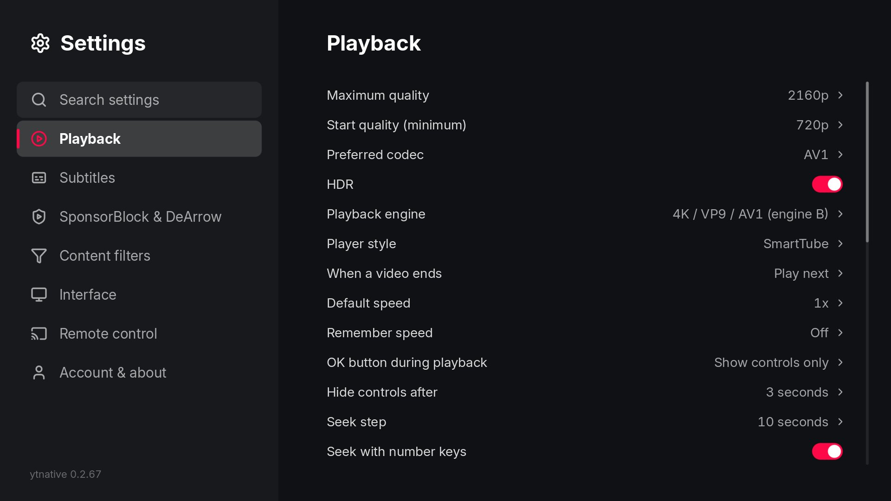
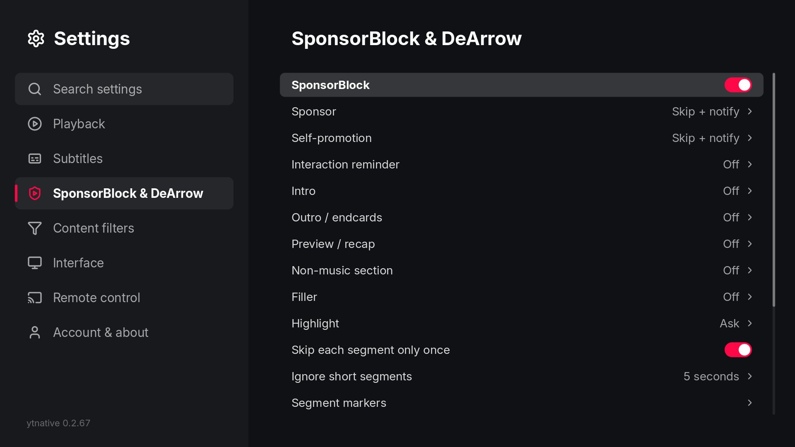
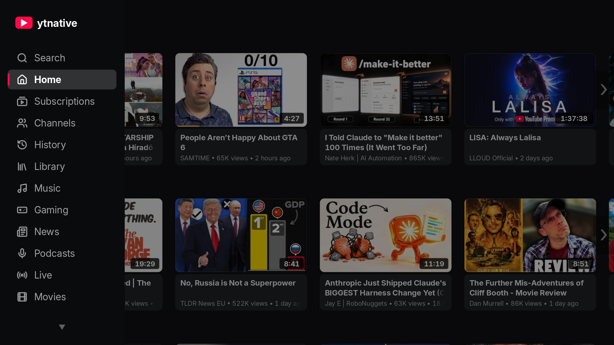
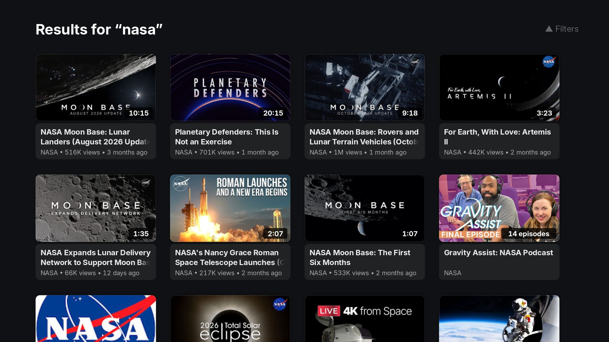
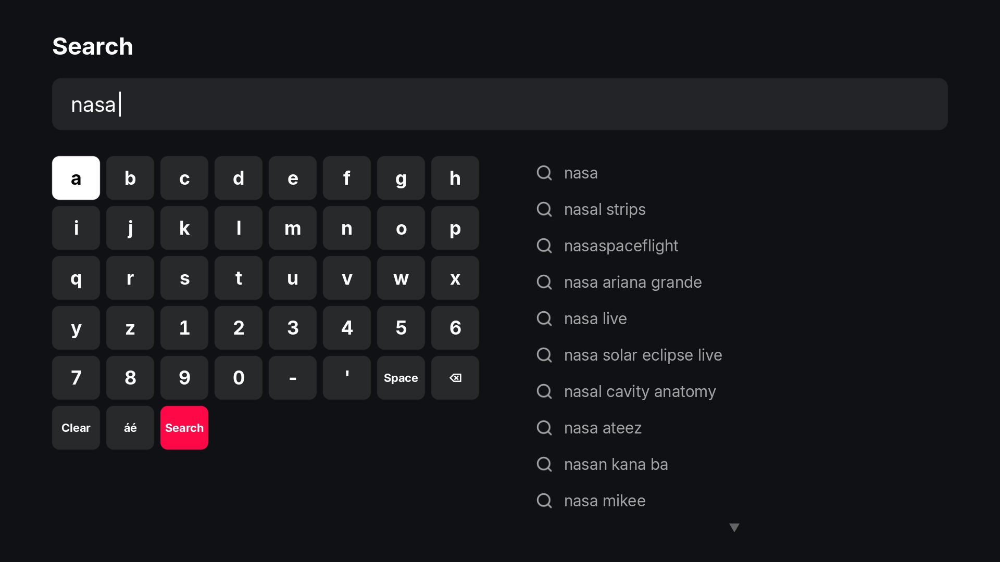
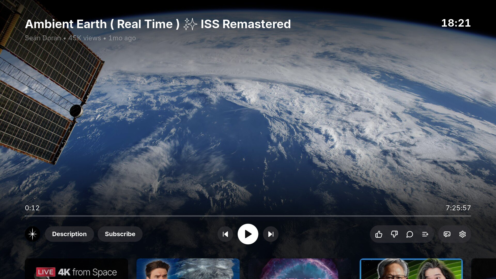
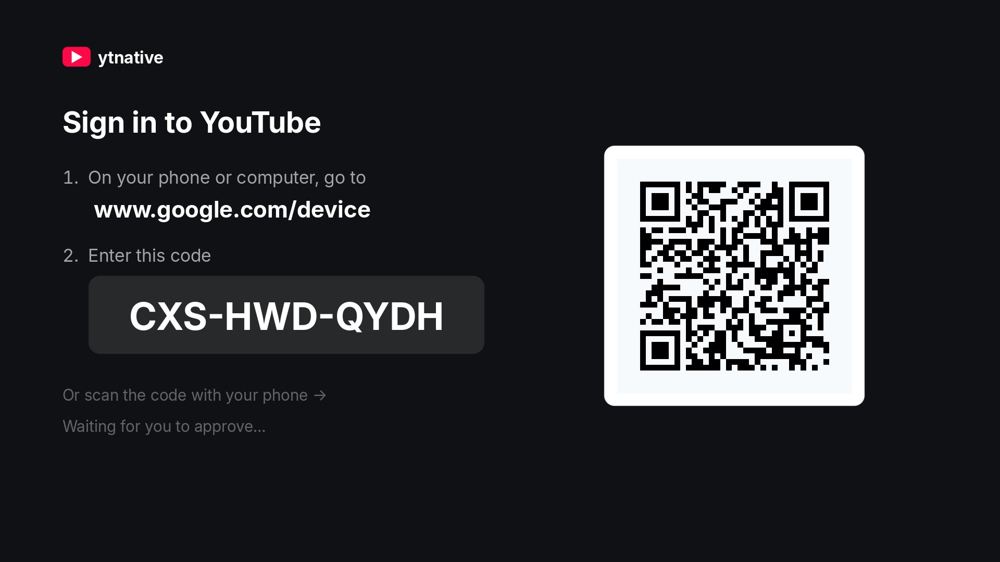

# ytnative: SmartTube for LG webOS

**ytnative is basically [SmartTube](https://github.com/yuliskov/smarttube) ported to LG webOS TVs.**
It is the same idea (an ad-free YouTube client made for the TV, with SponsorBlock, DeArrow,
Return YouTube Dislike and a big settings menu) rebuilt as a native Rust app. There is no browser,
no JavaScript engine and no Android runtime: the app draws its own UI with OpenGL ES and hands the
video straight to the TV's hardware decoder.

The UI core is vendored from [plx-native](https://github.com/GLinnik21/plx-native) (a native
webOS app framework); SmartTube is the feature reference throughout.

> Not affiliated with Google, YouTube, LG or the SmartTube project. Use at your own risk.

## Screenshots





| | |
|---|---|
|  |  |
|  |  |
|  |  |
|  | |

The player screenshots are from an LG C3; the others are from the app's Windows simulator, which
runs the same UI code as the TV build.

## Install

### Homebrew Channel (recommended)

1. Install the [webOS Homebrew Channel](https://github.com/webosbrew/webos-homebrew-channel)
   (needs Developer Mode or a rooted TV).
2. In the Homebrew Channel open **Settings > Add repository** and enter

   ```
   https://danzig666.github.io/ytnative/api/apps.json
   ```

3. **ytnative** shows up in the list. Install it; new releases show up as updates.

ytnative also looks for new releases itself and offers to install them (**Settings > Account &
about > Check for updates**).

### Developer Mode / manual

Download the `.ipk` from the [latest release](https://github.com/danzig666/ytnative/releases/latest)
and install it with LG's CLI:

```bash
ares-install --device <tv> io.github.danzig666.ytnative_<version>_arm.ipk
```

Root is not required.

### Requirements

- An LG TV with webOS 4 or newer. Tested on an LG C3 (OLED65C3, webOS 23 / 10.2.2), where it is developed,
  an LG BX (OLED55BX, webOS 5.5) and an LG C9 (OLED65C9, webOS 4.10.2; thanks to
  [2esq](https://github.com/2esq)). On webOS 4 video plays through the 4K engine only: no HDR yet, the
  picture stays full screen beside the comments, and speeds other than normal are not available.
  webOS 3 is not supported.
- Any GPU: the app links only the generic `libGLESv2`, loads EGL at runtime and falls back where
  an extension or shader precision is missing (developed on Mali; other GPUs are untested).
- A Google account is optional: sign in with a code from **Settings > Account & about** to get
  your Home, Subscriptions, History, playlists and notifications.

## Features

Everything SmartTube users expect, rebuilt for webOS:

**Browsing**
- Home, Subscriptions, Channels, History, Library/playlists, Notifications, Music, Gaming, News,
  Podcasts, Live, Movies, Sports, pinned playlists/channels, channel groups and search (on-screen
  keyboard, suggestions, filters, search history). Each sidebar section can be shown or hidden.
- Hidden sidebar that slides in from the leftmost tile or with BACK; a section opens with OK or a
  click, double BACK exits.
- Notifications: the newest videos of the channels whose bell is set to All videos.
- Titles under thumbnails, configurable card size, OLED black background, accent colours,
  optional clock on the video lists.
- Optional video previews: a muted preview plays in the card the focus rests on (Settings >
  Interface, off by default).
- Content filters: hide Shorts, watched videos, upcoming streams, mixes; block channels.
- Multiple accounts and brand accounts, settings PIN, child mode.

**Player**
- No ads. Up to 4K60, VP9 and AV1, **HDR10** (AV1), live streams.
- Two playback engines: the TV's own DASH player, and a direct hardware-decoder feed (the one
  used for 4K/VP9/AV1/HDR and live).
- SmartTube's two rows of on-screen controls (playback mode, speed, chapters, comments, search,
  channel, like / dislike, subtitles, save to playlist, subscribe, video info, SponsorBlock) and a
  suggestions row, all reachable with the arrow keys or the Magic Remote pointer. A YouTube-style
  control layout is the alternative.
- The subscribe button of a subscribed channel sets its notification bell (All videos,
  Personalized, None) or unsubscribes, as on YouTube.
- Chapter selector (a list of the video's chapters, OK jumps there), chapters on the seek bar,
  storyboard previews while seeking, resume where you left off, keep up with live streams,
  autoplay / repeat, playback speed (per channel if you like).
- **Audio only**: sound alone over a black screen, no video downloaded.
- **Same volume for every video**: loud videos are turned down, as YouTube's own players do.
- **Ambient mode**: a soft glow in the video's colours in the black bars of 4:3 videos, Shorts
  and films.
- **Video details**: engine, codecs, resolution, bitrates, buffer and connection speed over the
  video.
- Subtitles with size, colour, font, bold, outline / shadow / box styles and auto-translate.
- Comments in a side panel (the video shrinks beside it) with replies, and **live chat** beside
  live streams, each message with the time it was sent.
- Sleep timer: a countdown set in the player's options that runs across the next videos, warns a
  minute before and pauses playback.
- OSD, comments and subtitles are dimmed automatically over HDR video.

**Settings**
- Two panes: the categories (Playback, Subtitles, SponsorBlock & DeArrow, Content filters,
  Interface, Remote control, Account & about) on the left, their options on the right, on / off
  options as switches. **Search settings** finds any option by name.
- Playback modes (play next, repeat, list once / repeat / shuffle / reverse, pause or close after
  each video), remembered speed (per video, per channel, for all), OK button behaviour, auto-hide,
  seek step, number-key seeking, ending time, resume rules, preferred audio language.
- Subtitles per channel, thumbnail picture, content country, channels sorting.
- Content filters per section (Shorts, watched, upcoming, streams), blocked channels, watch and
  search history switches.

**Extras**
- **SponsorBlock** (per-category skip / ask / off, segment markers on the seek bar),
  **DeArrow** titles and thumbnails, **Return YouTube Dislike**.
- Cast from your phone: link with a TV code (Settings > Remote control), or, while the app is
  open, pick the TV from the YouTube app's cast menu (DIAL).
- Remote colour buttons can be mapped to actions; Magic Remote pointer, wheel and edge scrolling
  everywhere.
- Interface in English, Hungarian, German, Spanish, French and Russian.
- Settings backup and restore (USB or app storage).
- **Problem report** (Settings > Account & about): the app's logs on screen, and a QR code to
  download them on a phone on the same Wi-Fi, with sign-in tokens and stream addresses removed.
  Attach the report when you open an issue.

## How it works

- **YouTube API:** a pure-Rust InnerTube client (`crates/yt-core`). It signs in with the TV device
  flow, uses the TV client for your personal feeds and a JS-less client profile for stream URLs.
  The client profiles live in [`clients.json`](clients.json), which the app refreshes at runtime,
  so a YouTube change can usually be fixed without a new release.
- **UI:** plx-native's GLES2 renderer, focus engine and widgets, driven by SDL2 on the TV.
- **Video:** either a generated DASH manifest played by LG's media service, or demuxed MP4/WebM
  access units fed to LG's `StarfishMediaAPIs` (hardware decode of H.264/VP9/AV1, HDR metadata
  from the bitstream).
- **Build:** cross-compiled from Windows for 32-bit ARM with `zig` as the linker. CI links against
  stub libraries generated from symbol lists, so no LG binary is ever needed or committed.

## Building

Requirements: Rust (see `rust-toolchain.toml`), `python -m pip install ziglang==0.13.0`.

```bash
rustup target add armv7-unknown-linux-gnueabi
cargo test -p yt-core          # library tests
cargo xtask build              # cross-build for the TV (+ DT_NEEDED check)
cargo xtask ipk                # package target/ipk/io.github.danzig666.ytnative_<ver>_arm.ipk
cargo xtask install            # install on your TV over SSH (rooted TV; see docs/debugging.md)
```

A Windows simulator runs the same app in a 1920x1080 window (no video, everything else works):

```powershell
powershell -ExecutionPolicy Bypass -File tools/fetch-sim-deps.ps1   # once
cargo xtask sim
```

Every push is built by the [`ci`](.github/workflows/ci.yml) workflow. Tagging `vX.Y.Z` runs the
[`release`](.github/workflows/release.yml) workflow, which publishes the GitHub release and the
Homebrew Channel repository. See [docs/release.md](docs/release.md).

## Documentation

- [docs/release.md](docs/release.md): how releases and the Homebrew repository are built.
- [docs/debugging.md](docs/debugging.md): logs, crash symbolizing, TV tooling.
- [docs/feed-engine.md](docs/feed-engine.md): the hardware-decoder playback engine.
- [PLAN.md](PLAN.md): the original plan and the SmartTube feature matrix.

## Credits and license

- [SmartTube](https://github.com/yuliskov/smarttube) by Yurii Liskov: the app this ports.
- [plx-native](https://github.com/GLinnik21/plx-native) by Gleb Linnik and contributors: the
  vendored UI core and much of the webOS integration (GPL-3.0).
- [SponsorBlock](https://sponsor.ajay.app), [DeArrow](https://dearrow.ajay.app) and
  [Return YouTube Dislike](https://returnyoutubedislike.com) for their public APIs.
- [QuickJS-ng](https://github.com/quickjs-ng/quickjs) (MIT, `vendor/quickjs`) running
  [yt-dlp's ejs](https://github.com/yt-dlp/ejs) challenge solver (Unlicense, with meriyah (ISC)
  and astring (MIT) bundled; `vendor/ejs`): the stream URLs of signed-in playback.
- Fonts: Inter (OFL) and other bundled fonts with their licences in `crates/app/pkg`; DejaVu and Roboto (Apache-2.0) for subtitles.

ytnative is licensed under the GNU GPL v3.0 (see [LICENSE](LICENSE)).
